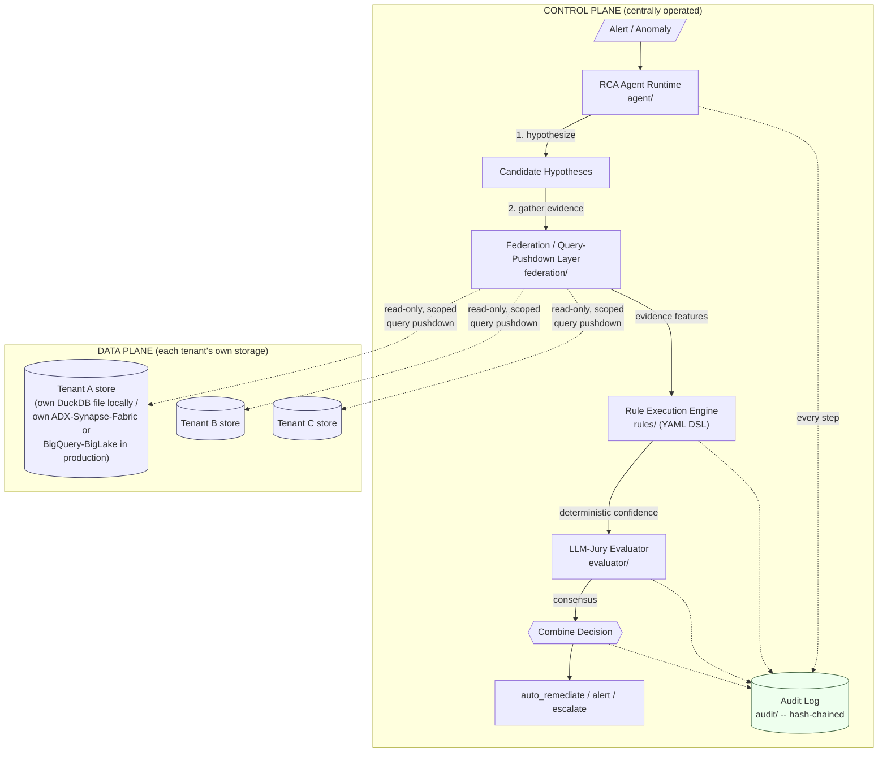
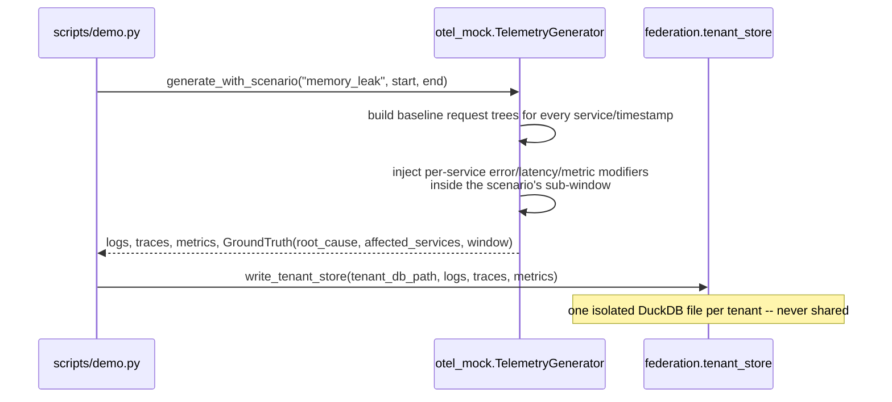
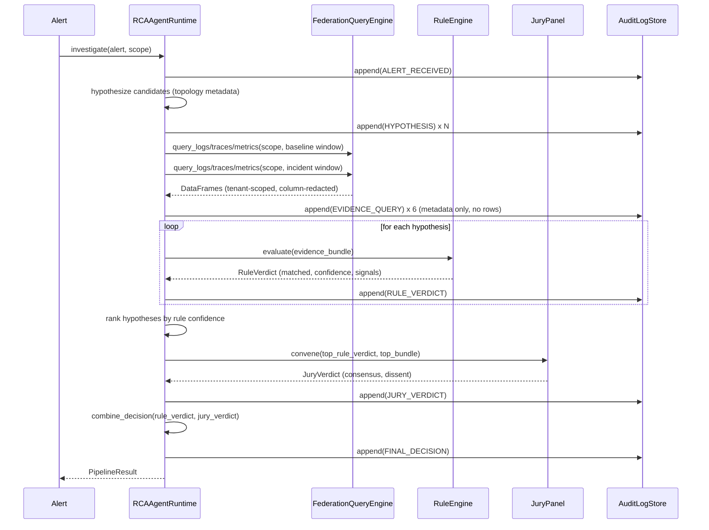
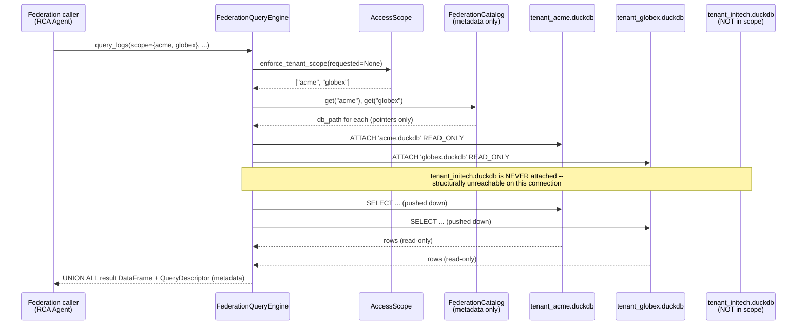

# telemetry-rca-agentic-runtime

**Automated root-cause analysis (RCA) with deterministic rule validation for
self-healing observability** -- and, as this repo's centerpiece, a
**zero-copy, multi-tenant RCA data model spanning Azure and GCP**: an
agentic pipeline that correlates evidence across services and tenants
*without ever copying a tenant's telemetry out of their own cloud account*.

```
OTel Mock Log/Trace/Metric Generator -> RCA Agent Runtime -> Rule Execution Engine -> Audit Log Store
                                              |
                                   Zero-Copy Federation Layer
                          (query pushdown across per-tenant stores)
```

> **Status**: a complete, runnable, fully-tested local system (Python 3.11+,
> DuckDB, pytest, Docker). The cross-cloud zero-copy architecture is
> **documented in depth and proven as a local functional analog** -- it is
> not a live Azure/GCP deployment. See [Limitations](#honest-limitations).

---

## Table of contents

- [Core concept](#core-concept)
- [Architecture](#architecture)
- [Quickstart](#quickstart)
- [Demo script](#demo-script)
- [Zero-copy multi-tenant data model](#zero-copy-multi-tenant-data-model)
- [The agentic RCA loop](#the-agentic-rca-loop)
- [Rule execution engine](#rule-execution-engine)
- [LLM-jury evaluator](#llm-jury-evaluator)
- [Audit log](#audit-log)
- [Testing](#testing)
- [Deployment](#deployment)
- [Honest limitations](#honest-limitations)
- [Repository layout](#repository-layout)

---

## Core concept

Most RCA demos either (a) assume all telemetry already lives in one place,
or (b) quietly centralize it there. This repo instead treats **"where is
the data allowed to live and who is allowed to touch it"** as a first-class
design constraint, equal in importance to the RCA logic itself:

1. **`otel_mock/`** generates realistic, labeled synthetic OTel-like
   telemetry for several simulated tenants, each with their own small
   microservice topology, and can inject one of five labeled failure
   scenarios with a ground-truth root cause attached.
2. **`federation/`** -- the centerpiece -- stores each tenant's telemetry in
   its own isolated store and answers cross-tenant/cross-service questions
   by pushing queries down into those stores, never copying rows into a
   shared table.
3. **`agent/`** runs an agentic loop: triage an alert, hypothesize
   candidate root causes, gather evidence via the federation layer, and
   rank hypotheses by evidence strength.
4. **`rules/`** is a deterministic, YAML-defined rule engine that turns
   gathered evidence into an explainable, reproducible confidence score --
   a fast baseline signal that doesn't depend on any model call.
5. **`evaluator/`** is a small panel of independent "judges" that votes on
   whether the top hypothesis is actually well-supported, and combines that
   with the rule engine's confidence into a final decision.
6. **`audit/`** is an immutable, hash-chained log of every step above,
   recording *what was queried and decided* -- never raw tenant data --
   with a tamper-detection function.

## Architecture



The control plane never holds a standing copy of tenant telemetry. Every
arrow crossing into the data plane is a scoped, read-only query; every
dotted arrow into the audit log is metadata only.

### Failure injection -> mock telemetry generation



### The full agentic RCA loop



### Zero-copy federated query flow



## Quickstart

Requires Python 3.11+ (tested with 3.11-3.13).

```powershell
git clone https://github.com/sehgalnamit/telemetry-rca-agentic-runtime.git
cd telemetry-rca-agentic-runtime
python -m venv .venv
.\.venv\Scripts\Activate.ps1      # Windows PowerShell
# source .venv/bin/activate       # macOS/Linux

pip install -r requirements.txt
pytest -q                         # 53 tests, fully offline

python scripts/demo.py --all --cross-tenant-federation-demo
```

Expected tail of the demo output for one scenario:

```
Top hypothesis: cascading_timeout -> pricing (rule confidence=0.90)
Jury: consensus_supports=True, mean_confidence=0.93, dissent_notes=0
Final decision: auto_remediate -- rule engine and jury both support the
hypothesis with high confidence (rule=0.90, jury=0.93)

Audit log: 27 entries, chain_intact=True (chain intact)

Scoring against ground truth: CORRECT (expected cascading_timeout/pricing)
```

### Docker

```powershell
docker compose config     # validate the compose file
docker compose up --build # runs the demo across all scenarios, then exits
docker compose down
```

> Docker was not available in the environment this repo was built in, so
> `docker compose up`/`build` could not be exercised here. The
> `docker-compose.yml` was validated by parsing it as YAML; see
> [Honest limitations](#honest-limitations).

## Demo script

`scripts/demo.py` is the single entry point for reproducing an end-to-end
labeled-scenario run:

```powershell
# One specific scenario
python scripts/demo.py --scenario bad_deploy

# Every scenario in the catalog, plus the standalone cross-tenant
# federation demo (separate from any one alert's investigation)
python scripts/demo.py --all --cross-tenant-federation-demo
```

For each scenario it: generates labeled synthetic telemetry, writes it into
an isolated per-tenant DuckDB file, fires a synthetic alert partway through
the injected failure window, runs the full agentic pipeline, prints the
ranked hypotheses / jury verdict / final decision, verifies the audit hash
chain, and scores the result against the ground truth. Exit code is
non-zero if any scenario's top hypothesis doesn't match ground truth.

## Zero-copy multi-tenant data model

This is the centerpiece of the repo -- see
**[`docs/ZERO_COPY_DATA_MODEL.md`](docs/ZERO_COPY_DATA_MODEL.md)** for the
full write-up. Summary:

- **Local analog (implemented and tested)**: each simulated tenant's
  telemetry lives in its own DuckDB file. `federation/query_layer.py`
  answers cross-tenant queries by `ATTACH`-ing, **read-only**, only the
  tenant files an `AccessScope` permits, then pushing a `UNION ALL` query
  down into them. Out-of-scope tenant files are never attached at all --
  refusal is structural, not just a runtime check. A lightweight
  `FederationCatalog` holds only `tenant_id -> db file path` metadata,
  never rows.
- **Production mapping (documented, not deployed)**:
  - **Azure**: ADX cross-cluster/cross-database queries, Synapse
    serverless SQL external tables over each tenant's own ADLS Gen2 via
    managed identity, Microsoft Fabric OneLake shortcuts (zero-copy
    references), and **Azure Lighthouse** for cross-tenant delegated RBAC
    access without moving data.
  - **GCP**: **BigQuery Omni** (query in place across clouds/regions),
    **Analytics Hub** (data sharing without copying), **BigLake
    authorized views** over each tenant's own GCS/BigQuery data, and
    cross-project IAM-scoped access.
- This is **a documented architecture plus a local functional analog that
  proves the federation pattern**, not a live cross-cloud deployment -- no
  real Azure/GCP cross-tenant resources were provisioned.

## The agentic RCA loop

`agent/runtime.py`'s `RCAAgentRuntime.investigate(alert, scope)`:

1. **Triage**: derive a baseline window (an earlier, presumed-healthy
   period) and an incident window (around the alert) from the alert
   timestamp.
2. **Hypothesize**: `agent/hypothesis.py` proposes a bounded set of
   candidates from topology *metadata* (the alerting service itself, its
   direct dependencies, its direct external dependencies, and same-node
   unrelated peers) -- one hypothesis per plausible root-cause type.
3. **Gather evidence**: issues six scoped, read-only federated queries
   (logs/traces/metrics x baseline/incident) via `federation/`, never
   copying rows; builds a per-hypothesis `EvidenceBundle` of aggregated
   features (error rates, latency ratios, metric trends, log pattern
   matches, attribute changes).
4. **Rank hypotheses**: runs the deterministic rule engine over each
   bundle and sorts by resulting confidence.
5. **Jury gate + decide**: convenes the jury on the top hypothesis and
   combines rule + jury into `auto_remediate` / `alert` / `escalate`.

Every step is appended to the hash-chained audit log.

## Rule execution engine

`rules/definitions/default_rules.yaml` defines one deterministic signature
per failure type as a set of `SignalCondition`s (e.g. `latency_ratio_gte`,
`log_pattern`, `metric_trend_ratio_gte`, `attribute_changed`,
`peer_shared_node_degraded`), each targeting either the hypothesis's
primary candidate or any other service in the evidence bundle. A rule fires
when enough of its signals match (`min_match_ratio`), producing a fixed,
reproducible confidence -- no randomness, no model call, fully explainable
via `RuleVerdict.rationale` and the matched/unmatched signal lists.

Scored against the 5 labeled scenarios in `otel_mock/scenarios.py`, this
achieves perfect precision and recall (see
`tests/test_rules.py::test_rule_engine_precision_and_recall_across_all_scenarios`)
-- on this canonical, well-separated scenario set; it is not a claim about
production incident diversity.

## LLM-jury evaluator

`evaluator/` implements a small panel of **independent, deterministic
judges** (CI-safe, no external calls) that each look at the rule verdict +
evidence from a different angle:

- `RuleAlignmentJudge` -- mirrors the rule engine's own verdict.
- `EvidenceCoverageJudge` -- looks only at the fraction of signals matched.
- `ConservativeSkepticJudge` -- a deliberately stricter bar (every signal,
  including optional ones, must match at high confidence); this is the
  judge most likely to dissent on borderline matches, by design.

`JuryPanel.convene()` aggregates votes into a majority consensus, mean
confidence, and **visible dissent notes** rather than a single smoothed
number. `evaluator/decision.py` then combines the rule engine's
confidence with the jury consensus:

| Rule engine | Jury | Confidence | Action |
|---|---|---|---|
| matched | supports | both >= high threshold | `auto_remediate` |
| matched | supports | moderate | `alert` |
| disagree, or either confidence low | -- | -- | `escalate` |

**Honest grounding**: a diverse panel reduces the single-point-of-failure
bias/variance of asking one judge once, and a small panel of cheap,
deterministic heuristics is faster/cheaper than one large model call by
construction -- this repo does not claim or fabricate any benchmark
numbers about accuracy uplift. `evaluator/judges.py` documents an
unimplemented `LLMJudge` extension point for plugging in a real small/local
model; it is intentionally not wired in, to keep CI fully offline.

## Audit log

`audit/log_store.py`'s `AuditLogStore` is an append-only, in-memory (and
optionally JSONL-exportable) log where every entry embeds the SHA-256 hash
of the previous entry:

```
entry_hash[i] = sha256(index, timestamp, entry_type, tenant_id, payload, prev_hash[i])
prev_hash[i+1] = entry_hash[i]
```

`verify_chain()` walks the whole chain, recomputing each hash and checking
each `prev_hash` link; any tampered payload or reordered entry is detected
and reported with the index where the break occurs. Every payload is
metadata only -- alert fields, hypothesis descriptions, `QueryDescriptor`s
(table/tenants/columns/row-count, never raw rows), rule/jury verdicts, and
final decisions -- preserving zero-copy even inside the audit trail itself.

## Testing

```powershell
pytest -q                               # all 53 tests
pytest -q --cov=. --cov-report=term-missing   # with coverage (97% at last run)
```

| Module | What's covered |
|---|---|
| `tests/test_otel_mock.py` | Generator determinism (same seed -> identical output), ground-truth labeling correctness for all 5 scenarios, external-dependency-emits-no-telemetry invariant |
| `tests/test_federation.py` | Cross-tenant federated query correctness, structural out-of-scope refusal, column redaction, metadata-only `QueryDescriptor` shape |
| `tests/test_rules.py` | Per-scenario top-verdict correctness + precision/recall across the labeled scenario catalog |
| `tests/test_jury.py` | Consensus/dissent aggregation, rule+jury decision-combination policy (auto_remediate/alert/escalate) |
| `tests/test_audit.py` | Hash-chain integrity, tamper detection (payload edit + reordering), JSONL export |
| `tests/test_e2e.py` | Full pipeline per scenario: correct root cause, complete/intact audit trail, no raw telemetry text leaking into audit payloads, end-to-end tamper detection |

Everything runs fully offline with no external API keys.

## Deployment

- **[`docs/AZURE_DEPLOYMENT.md`](docs/AZURE_DEPLOYMENT.md)** +
  **[`deployment/azure/`](deployment/azure/)**: Bicep templates for the
  control plane (Container Apps, Container Registry, Key Vault, Log
  Analytics + Application Insights) and a standalone Azure Lighthouse
  delegation template. **Illustrative only -- not applied to any live
  subscription.**
- **[`docs/GCP_DEPLOYMENT.md`](docs/GCP_DEPLOYMENT.md)** +
  **[`deployment/gcp/`](deployment/gcp/)**: Terraform for the control
  plane (Cloud Run v2, Artifact Registry, Secret Manager, Monitoring/Trace
  IAM) and an illustrative cross-project BigQuery IAM binding.
  **Illustrative only -- not applied to any live project.**
- **[`docs/ZERO_COPY_DATA_MODEL.md`](docs/ZERO_COPY_DATA_MODEL.md)**: the
  full architecture deep-dive tying both clouds' data-plane primitives back
  to the local `federation/` implementation.

## Honest limitations

- **No real cross-cloud deployment.** `deployment/azure/` and
  `deployment/gcp/` are reviewable, syntactically-checked IaC templates.
  They were not `terraform apply`'d or `az deployment group create`'d
  against a live subscription/project in this exercise.
- **Local analog, not a live federation.** The zero-copy query pattern is
  fully implemented and tested with DuckDB `ATTACH` on one machine. It
  proves the pattern (metadata catalog, scoped read-only attach, pushdown
  query, structural isolation) works and is testable -- it does not itself
  span clouds. DuckDB cannot attach to an ADX cluster or a BigQuery
  dataset.
- **Docker was not available in this build environment.** `docker compose
  up --build` could not be exercised here; the compose file was validated
  by parsing it as YAML, and the equivalent flow (`scripts/demo.py --all`)
  was run directly and verified.
- **Synthetic, labeled scenarios only.** The rule engine's perfect
  precision/recall is measured against this repo's own 5 canonical,
  well-separated injected scenarios -- it is not a claim about production
  incident diversity or ambiguity.
- **Jury judges are deterministic stubs.** No real LLM call is wired in by
  default (by design, for offline CI); `evaluator/judges.py` documents how
  to add one.

## Repository layout

```
otel_mock/      synthetic OTel-like log/trace/metric generator + labeled failure scenarios
federation/     zero-copy, multi-tenant federated query layer (the centerpiece)
agent/          agentic RCA loop: triage, hypothesize, gather evidence, rank
rules/          deterministic YAML rule DSL + evaluation engine
evaluator/      LLM-jury panel + rule/jury decision combination
audit/          hash-chained, append-only audit log
common/         shared, generic call-graph helpers
tests/          pytest suite (53 tests, fully offline)
scripts/        demo.py -- CLI entry point for the end-to-end demo
deployment/     Azure (Bicep) + GCP (Terraform) illustrative IaC templates
docs/           ZERO_COPY_DATA_MODEL.md, AZURE_DEPLOYMENT.md, GCP_DEPLOYMENT.md
.github/workflows/ci.yml   lint (ruff) + pytest on every push/PR
Dockerfile, docker-compose.yml   local demo container
```

## License

[MIT](LICENSE)
