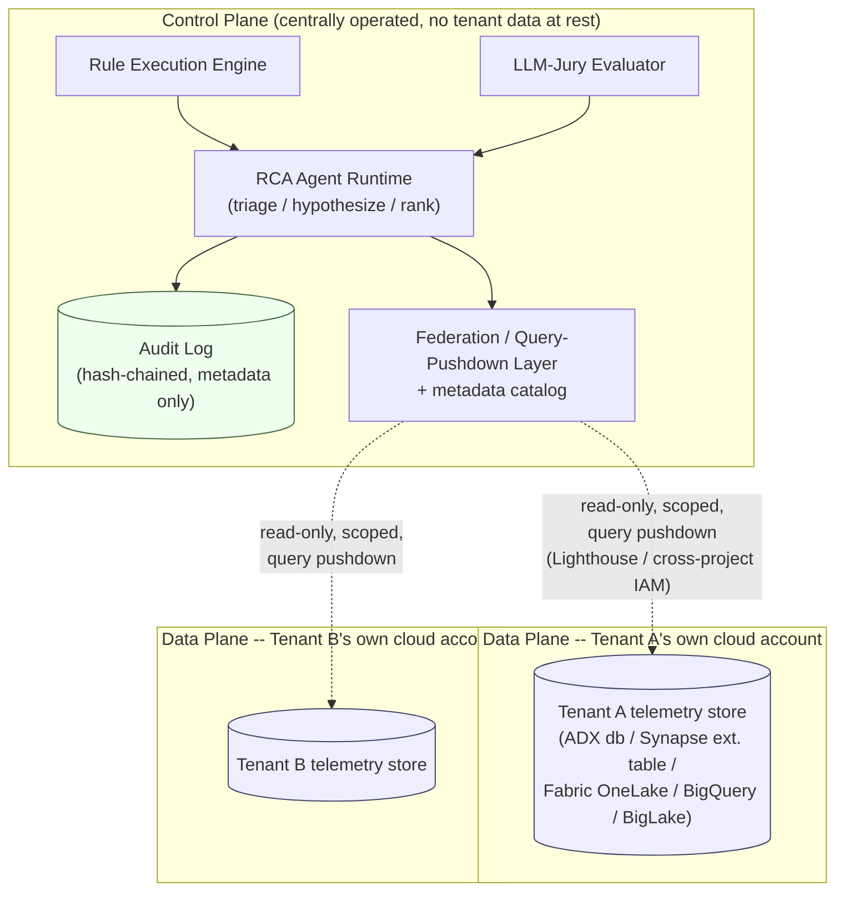

# The Zero-Copy, Multi-Tenant RCA Data Model

This is the centerpiece design of this repository: how root-cause analysis
can correlate evidence **across services and across tenants** without ever
copying a tenant's telemetry out of that tenant's own storage account,
project, or subscription.

> **Honesty up front.** This document describes a real architecture pattern
> *and* a local, fully functional analog that proves the query-federation
> mechanics on one machine with DuckDB. It is **not** a live cross-cloud
> deployment: no real Azure or GCP cross-tenant resources were provisioned
> as part of this repository. The local analog and the production mapping
> are clearly separated below.

## Why zero-copy matters here

A naive multi-tenant RCA system centralizes everyone's logs/traces/metrics
into one shared warehouse so it can be queried together. That creates real
problems this design avoids entirely:

- **Data residency / compliance**: tenant data never leaves the tenant's
  own account, region, or regulatory boundary.
- **Blast radius**: a breach of the central store cannot expose every
  tenant's raw telemetry, because there is no central store of raw rows.
- **Staleness and cost**: there is no ETL pipeline to build, schedule,
  monitor, or pay storage for a second time.
- **Least privilege**: the control plane only ever holds a *scoped,
  read-only* credential/connection, never a copy of the data it reasons
  about.

The trade-off is that every cross-tenant/cross-service question must be
answered as a **federated query pushed down** into each tenant's own store,
rather than a single local table scan. This repository's `federation/`
package exists to make that federation layer explicit, testable, and
auditable instead of an assumed implementation detail.

## Local functional analog (what actually runs in this repo)

```
federation/
├── catalog.py        # metadata-only: tenant_id -> db file path, exposed tables
├── tenant_store.py    # writes one tenant's telemetry into its OWN duckdb file
├── access_control.py  # AccessScope: allowed tenants + per-table column redaction
└── query_layer.py      # FederationQueryEngine: ATTACHes only in-scope tenant
                         # files READ_ONLY, UNION ALLs across them, pushes the
                         # query down -- never copies a row into a shared table
```

### Storage: one DuckDB file per tenant

Each simulated tenant (`acme`, `globex`, `initech` -- see
`otel_mock/topology.py`) gets its own DuckDB file
(`data/tenants/<tenant_id>.duckdb`), written once by
`federation.tenant_store.write_tenant_store()`. No code path in this repo
ever reads one tenant's file and writes its rows into another file or into
a shared table. That is the whole zero-copy guarantee at the storage layer:
**there is no shared table to copy into.**

### Metadata catalog: pointers, not data

`federation.catalog.FederationCatalog` holds a `TenantRegistration` per
tenant: `tenant_id`, `db_path`, and the list of exposed table names. That
is *all* it holds. It is the local analog of a cross-cloud discovery/schema
layer (a Fabric OneLake shortcut registry, a BigQuery Omni/Analytics Hub
listing, an Azure Lighthouse delegation registry): metadata about *where*
data lives and *what shape* it has, never the rows themselves.

### Access control: least privilege, enforced structurally

`federation.access_control.AccessScope` is a read-only, least-privilege
grant: a principal name, an explicit allow-list of tenant ids, and an
optional per-table list of columns to redact (null out) even for in-scope
tenants. `enforce_tenant_scope()` raises `PermissionError` the instant a
caller asks for a tenant outside that allow-list.

Critically, this is enforced **structurally**, not just by a check you
could bypass with raw SQL: `FederationQueryEngine._open_scoped_connection()`
only ever `ATTACH`es the tenant database files that are in scope, in
`READ_ONLY` mode. A tenant's file that is not in scope is **never attached
to the connection at all** -- there is no table reference to it that any
SQL on that connection, however creative, could reach. This is verified in
`tests/test_federation.py::test_query_is_pushed_down_without_touching_out_of_scope_tenant_db`
and the explicit refusal test
`test_out_of_scope_tenant_request_is_refused`.

### Query execution: pushdown, not pull-then-filter

`FederationQueryEngine.query_table()` builds one `SELECT ... UNION ALL
SELECT ...` statement, one branch per in-scope tenant, each branch
referencing that tenant's own attached schema
(`tenant_<id>.<table>`), and lets DuckDB execute it. DuckDB pushes the
column selection and any `WHERE` filters down into each attached file
individually -- the federation layer's job is to *shape* the query safely,
not to pull everything into Python and filter there. The convenience
wrappers (`query_logs`, `query_traces`, `query_metrics`) build simple,
parameterized `WHERE` clauses (service/time-range/severity/status) so the
RCA agent never hand-writes SQL against raw tenant data.

### Column-level redaction

Even within an allowed tenant, `AccessScope.redacted_columns` can null out
specific columns (e.g. hiding free-text `message` content for an auditor
role that should see *that an error occurred* but not its log text). This
is implemented by rewriting the column list in the generated `SELECT`
(`NULL AS <column>` for redacted columns) against a fixed per-table
column whitelist (`federation.tenant_store.TABLE_COLUMNS`), so a caller can
never inject an arbitrary column/table reference through this path either.

### What gets logged about a query (and what never does)

Every federated query returns a `QueryDescriptor`: principal, table,
resolved tenant ids, selected/redacted columns, filter shape, and row
count. No telemetry value ever appears in it. This is exactly what the
audit log (`audit/`) persists for every evidence-gathering step the RCA
agent takes -- see `tests/test_e2e.py::test_pipeline_audit_trail_never_contains_raw_telemetry_text`.

## Mapping to production: Azure

| Local analog | Azure equivalent |
|---|---|
| One DuckDB file per tenant | Each tenant's own Azure Data Explorer (ADX) cluster/database, or Synapse serverless SQL external tables over their own ADLS Gen2 storage account, or a Microsoft Fabric OneLake item |
| `FederationCatalog` (metadata only) | A schema/discovery layer tracking which ADX database / Synapse external table / OneLake shortcut belongs to which tenant |
| `ATTACH ... READ_ONLY` per query | **ADX cross-cluster/cross-database queries** (`cluster('...').database('...')` in KQL) reading each tenant's ADX database directly; or **Synapse serverless SQL** querying external tables that point at the tenant's own ADLS Gen2 storage via a database-scoped credential using **managed identity**, never a copy of the files; or a **Fabric OneLake shortcut**, which is a zero-copy *reference* to data that physically stays in the source location (another OneLake item, ADLS Gen2, S3, etc.) |
| `AccessScope` + structural ATTACH restriction | **Azure Lighthouse**: the tenant (not the control-plane operator) creates a delegation (`Microsoft.ManagedServices/registrationDefinitions` + `registrationAssignments`) granting the control plane's service provider tenant a *specific, scoped RBAC role* (e.g. Reader, Monitoring Reader) on *specific resources* within the tenant's own subscription -- access is delegated, the subscription boundary and the data never move. See `deployment/azure/lighthouse-delegation.bicep` and `docs/AZURE_DEPLOYMENT.md` |
| `QueryDescriptor` → audit log | Azure Monitor / Log Analytics query audit logs, or a custom audit sink fed by the control plane, recording *what was queried* (KQL text, scope, row count) without re-ingesting tenant data rows into the control plane's own workspace |

Least-privilege in Azure terms: the control plane is granted a Lighthouse
delegation scoped to **read-only roles on specific resources**, which is
the cloud-native equivalent of this repo's `AccessScope.allowed_tenant_ids`
-- a capability grant, not a data copy.

## Mapping to production: GCP

| Local analog | GCP equivalent |
|---|---|
| One DuckDB file per tenant | Each tenant's own BigQuery dataset, or a GCS bucket exposed via BigLake |
| `FederationCatalog` (metadata only) | Analytics Hub listings (published, discoverable references to a dataset) or a lightweight internal registry of which tenant project/dataset to query |
| `ATTACH ... READ_ONLY` per query | **BigQuery Omni**: query data in place across clouds/regions without moving it; **BigLake authorized views**: a view in the control plane's project that is granted access to query a table in the tenant's own BigQuery dataset or GCS bucket, without granting broad access to the underlying data; **Analytics Hub**: the tenant publishes a *linked dataset* the subscriber queries directly against the source, again without a copy |
| `AccessScope` + structural ATTACH restriction | **Cross-project IAM**: the tenant grants a narrowly-scoped role (e.g. `roles/bigquery.dataViewer` on one dataset, or a BigLake authorized view only exposing specific columns/rows) to the control plane's service account in the tenant's own project -- see the illustrative, intentionally no-op-by-default `google_bigquery_dataset_iam_member` resource in `deployment/gcp/main.tf` |
| `QueryDescriptor` → audit log | BigQuery's own query audit logs (Cloud Audit Logs / `INFORMATION_SCHEMA.JOBS`) plus a custom audit sink in the control plane recording query shape and scope, mirroring the metadata-only `QueryDescriptor` |

## Architecture: control plane vs. data plane



The arrows crossing the control-plane/data-plane boundary are **queries
in, result rows out** -- scoped, read-only, and logged as metadata. No
arrow ever represents a bulk copy, ETL job, or replication pipeline.

## What this repo does *not* claim

- No real Azure or GCP cross-tenant resources were provisioned. The
  `deployment/azure/` and `deployment/gcp/` templates are illustrative and
  have not been `terraform apply`'d or `az deployment group create`'d
  against a live subscription/project as part of this exercise.
- The local DuckDB `ATTACH`-based engine is a **functional analog** that
  proves the federation *pattern* (scoped attach, pushdown query, metadata
  catalog, structural tenant isolation) works end-to-end and is testable.
  It is not itself a cross-cloud system -- DuckDB cannot attach to an ADX
  cluster or a BigQuery dataset. The production mapping tables above
  describe how the same pattern maps onto real Azure/GCP primitives; they
  are not implemented in code here.
- No invented benchmark numbers or vendor claims are made about the
  production primitives referenced (ADX, Lighthouse, Fabric OneLake,
  Synapse serverless, BigQuery Omni, Analytics Hub, BigLake) beyond their
  documented purpose: query/reference data in place without copying it.
